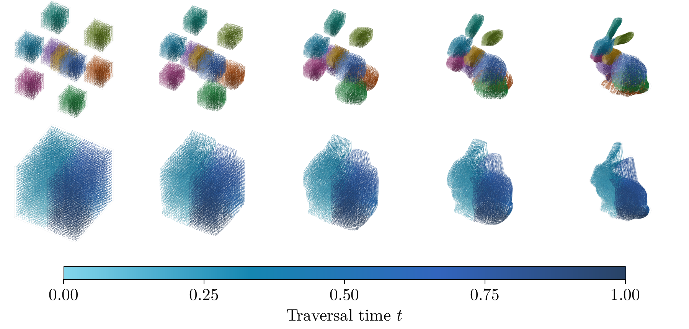

# The Topology of Slicing: A Map-Chain Framework for Slicer Design

Pierre-Olivier Bolduc, 2026. **[Paper (PDF)](paper/main.pdf)**

This repository holds the paper and the code behind it: transported Hilbert paths,
near-convex decomposition, the planar 3R comparison, and every figure and generated
table in the paper.

[](paper/figures/bunny_transport_decomposition.pdf)

Hilbert paths transported into the Stanford Bunny: nine independent source pieces
(top), and one whole-part source (bottom). [Figure PDF](paper/figures/bunny_transport_decomposition.pdf).

## Abstract

A slicer bundles several decisions into one algorithm: which source to traverse, in
what order, how to place it in the part, how to move the machine, and how to deposit
material. Two slicers therefore differ in several decisions at once, and a limit they
share can go unnoticed. We describe a slicer as a chain of maps, from a source through
the part and the machine to the built part. Each decision becomes a link, and
guarantees of coverage, continuity, and containment, together with bounds on
implementation error, compose along the chain. The chain gives slicers a common
description, traces each guarantee or failure to the link that supplies it, and yields
new slicers by changing a link or the order in which the links are built, with the
composition rules stating which guarantees survive and which become obligations. We
demonstrate the framework on forced interruptions, which are topological: a plan that
must visit $c$ path components is interrupted at least $c-1$ times. At the source,
every reviewed solid-filling slicer traverses separate layers or surfaces, so its stops
grow with resolution. Replacing the source by one connected volume, ordered by a
three-dimensional Hilbert curve and carried into the part by optimal transport, gives a
continuous path with the prescribed occupation measure on convex parts. In a
computational prototype, this path makes no stops on convex parts, where a layered
raster's stops roughly double with resolution; on non-convex parts, splitting the
source into near-convex pieces trades a fixed number of transitions for bounded
excursions. At the machine, the components are the posture sheets of the robot's safe
configurations. Reversing the construction order gives kinematics-first slicing, in
which the sheets guide the source split: on a three-link planar arm among obstacles, it
makes the two sheet switches that the bound requires in a sampled availability model,
whereas a geometry-first baseline makes four.

## Setup

Python 3.13:

```powershell
python -m venv .venv
.venv\Scripts\Activate.ps1
python -m pip install -r requirements.txt
```

The semi-discrete solver is a small C++ adapter around
[Geogram](https://github.com/BrunoLevy/geogram) 1.10.1. Building it requires Windows,
MSVC with the Windows SDK, CMake and Ninja; the source archive is downloaded and its
checksum verified. Sources and builds go to `.geogram/`. The nested solver uses the
second build.

```powershell
python -m mapchain build
python -m mapchain build --warmstart --lbfgs-handoff 0.5
```

Figures also need a LaTeX installation with `lmodern`.

## Commands

`python -m mapchain` lists the commands; append `--help` to any of them. Experiment
and benchmark commands write to `results/` (overwriting their earlier outputs);
`build` writes to `.geogram/`, and `figures` and `tables` write into `paper/`.
The `validate`, `uniform`, `raster`, `decompose`, `compare`,
`tables` and `figures` commands support `--check`: they compare their output with
the saved results instead and write nothing. `kinematics` also supports `--check`.
`build` and `benchmark` do not support it. In the order used for the paper:

```powershell
python -m mapchain validate                        # solver checks on the cube and torus
python -m mapchain uniform --orders 4 5 6          # whole-part paths, five targets
python -m mapchain uniform --parts box --orders 2
python -m mapchain uniform --parts bunny --orders 5
python -m mapchain raster                          # layered raster baseline
python -m mapchain decompose --object l_box
python -m mapchain decompose --object torus --threshold 0.05
python -m mapchain decompose --object torus --threshold 0.05 --m 3 --out torus_m3
python -m mapchain decompose --object bunny --threshold 0.1
python -m mapchain compare                         # whole torus vs pieces, same budget
python -m mapchain tables                          # paper/tables/*.tex, from the saved results
python -m mapchain kinematics                      # planar 3R comparison
python -m mapchain benchmark --prep
python -m mapchain benchmark --method geometry
python -m mapchain benchmark --method kinematics
python -m mapchain figures                         # paper/figures/*.pdf; --only NAME for one
```

Uniform paths use the nested solver at Hilbert order $m$, with $8^m$ waypoints. The
targets are the cylinder, sphere, torus, L-bracket (`l_box`) and a genus-3 complex
part. Piece paths are order four; the order-three torus pieces match the 4096-waypoint
figure budget. Higher orders take substantial time and memory.

The 3R comparison uses unit links `(1, 1, 1)`, three disk obstacles, radii 2.35-2.7
and tool angles from -45 to 45 degrees, with uniform and gradient density at orders
three to five. Posture resets
are discrete; collision bounds apply to continuous stretches. Hull-gap bounds are
numerical; segment containment, fibre availability, coverage, density and tracking are
sampled.

Tests: `python -m unittest discover -s tests -t .`. They include consistency checks of
the saved 3R results in `results/kinematics` and check that every table in
`paper/tables/` is what the saved results produce. Lint with
`python -m pip install -e .[dev]`, then `ruff check` and `ruff format --check`.

## Building the paper

Requires a TeX distribution with `latexmk`, pdfLaTeX and BibTeX. From `paper/`:

```sh
latexmk -pdf main.tex
```

The PDF is written to `paper/main.pdf`. Auxiliary files and the TikZ cache stay in
`paper/build/`, which is created automatically and can be deleted at any time. The
configuration enables shell escape for TikZ externalisation. Use `latexmk -g -pdf
main.tex` to force a rebuild.

[`latexindent`](https://latexindentpl.readthedocs.io/en/stable/sec-how-to-use.html)
formats the LaTeX source with the local two-space configuration:
`latexindent -l -wd -s -c=build/format main.tex`. Formatting is not part of the build.

## Layout

The package follows the paper.

| Application | Code | Saved results | Paper sections |
| --- | --- | --- | --- |
| Volumetric transport and near-convex decomposition | [Volumetric](mapchain/volumetric/) | [Validation and decomposition](results/volumetric/) | [Section 3](paper/sections/03_volumetric.tex), [Appendix B](paper/appendices/B_volume.tex) |
| Whole-part paths, raster baseline and piece comparison | [Evaluation](mapchain/evaluation/) | [Evaluation results](results/evaluation/) | [Section 4](paper/sections/04_volumetric_evaluation.tex), [Appendix C](paper/appendices/C_experiments.tex) |
| Geometry-first and kinematics-first planar 3R planning | [Kinematics](mapchain/kinematics/) | [3R results and benchmarks](results/kinematics/) | [Section 5](paper/sections/05_kinematics_first.tex), [Appendix D](paper/appendices/D_kinematics.tex) |

See [the results guide](results/README.md) for file contents and regeneration commands.

```text
mapchain/              the code
  volumetric/          Sec. 3, first application: changing the source
    hilbert.py           Hilbert traversal of the source cube
    transport.py         semi-discrete optimal transport (Geogram adapter)
    parts.py             target parts and inside tests
    decomposition.py     repair: near-convex source pieces
    native/              adapter.cpp and its build script
  evaluation/          Sec. 4 and App. C, evaluating the first application
    metrics.py           containment, deposition, coverage, locality
    whole_part.py        solver validation and whole-part paths
    raster.py            layered raster baseline
    pieces.py            decomposed vs whole paths
  kinematics/          Sec. 5 and App. D, second application: changing the construction order
    arm.py               planar 3R arm, IK, certificates, patches
    sheets.py            posture sheets, geometry-first and kinematics-first planning
    benchmark.py         timings and comparison table
  figures/             one module per paper figure, named like its PDF
  tables.py            the paper's five data tables, one function per .tex
  store.py             saving results and --check
tests/
models/                STL inputs
results/               the results the paper reports
paper/
  main.tex, refs.bib
  sections/, appendices/, style/
  figures/             written by python -m mapchain figures
  tables/              written by python -m mapchain tables
```

- `models/`: the Stanford Bunny's source and attribution are in
  [`models/bunny_source.json`](models/bunny_source.json).
- `results/`: the same tree as the package (`volumetric/`, `evaluation/`,
  `kinematics/`). Each command rewrites its own files. Runs keep their metrics;
  waypoints are kept only for the runs that the figures and the torus comparison read
  back.
- `.geogram/` (Geogram builds) and `.cache/` (CoACD hulls) are local and not tracked.

## How to cite

```bibtex
@misc{bolduc2026topology,
  author = {Bolduc, Pierre-Olivier},
  title  = {The Topology of Slicing: A Map-Chain Framework for Slicer Design},
  year   = {2026},
  month  = oct
}
```

See also [`CITATION.cff`](CITATION.cff).

## License

- Code (`mapchain/`, `tests/`) and saved results: MIT; see [LICENSE](LICENSE).
- Paper (`paper/`: text, figures, tables and the PDF): CC BY 4.0; see
  [paper/LICENSE](paper/LICENSE).
- The Stanford Bunny is from the Stanford 3D Scanning Repository; see
  [`models/bunny_source.json`](models/bunny_source.json). The bunny mesh
  (`models/bunny.stl`), the results derived from it (`results/volumetric/decomposition/bunny/`,
  `results/evaluation/whole_part/bunny_m5.*`) and the bunny figure
  (`paper/figures/bunny_transport_decomposition.pdf` and `.png`) are not covered by the MIT
  or CC BY licenses above: they remain under the Stanford repository's terms, which allow
  research use and redistribution but ask that commercial use be cleared with Stanford.
